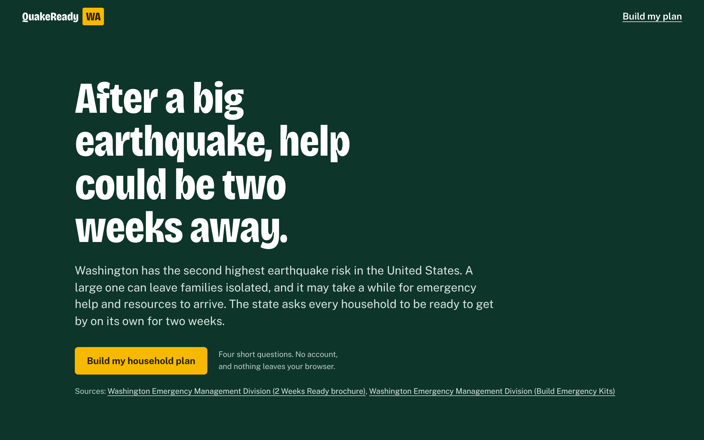
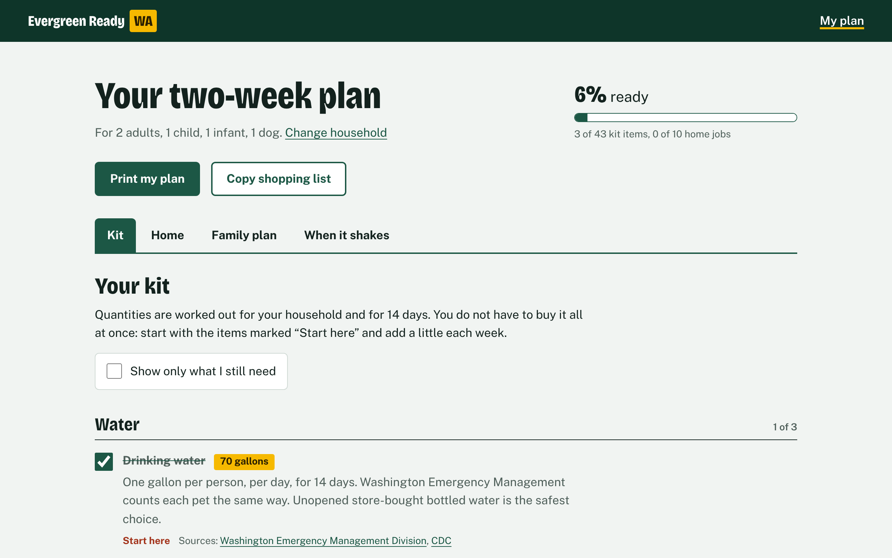

# QuakeReady WA

A two-week earthquake kit and family plan, sized to your household.

Built for WarriorHacks 2.0. Theme: create a project that solves an issue in your community, county, state, or nation.

   Live demo: https://quakeready-wa.vercel.app



## The problem

Washington has the second highest earthquake risk in the United States. The U.S. Geological Survey gives the Puget Sound region an 85 percent chance of a magnitude 6.5 or greater deep earthquake in the next 50 years, the same kind as the 2001 Nisqually earthquake that caused several billion dollars in damage. The state also sits next to the Cascadia Subduction Zone, which last ruptured in 1700 at about magnitude 9.

After a large earthquake, help may take a while to arrive, so Washington Emergency Management asks every household to be "2 Weeks Ready": able to get by on its own for 14 days. The official advice is good but generic. It is a list of categories, and it is left to each family to work out what "two weeks of water" means for two adults, a baby, a grandparent on medication, and a dog. That gap between knowing you should prepare and knowing exactly what to buy is where most people stop.

## What it does

QuakeReady WA asks four short questions about who lives in your home, your pets, any medical or mobility needs, and the home itself. From the answers it builds a plan with four parts.

Kit. A checklist with quantities worked out for your household, such as 56 gallons of water for three people and a dog. Items are marked "Start here", "Next", or "When you can" so a family on a budget knows what to buy first. Items only appear if they apply to you: formula for infants, hearing aid batteries, a car kit.

Home. One-time jobs that make the home safer and mostly cost nothing. The list changes if you rent, have natural gas, or live near the water.

Family plan. The blanks every household should fill in: an out-of-area contact, two meeting places, where the utility shutoffs are. Households near saltwater are asked for their high ground, and households with children, pets, or older adults get fields for them.

When it shakes. What to do during and right after an earthquake, including the versions for someone in a wheelchair, in bed, driving, or near the shore.



You can check things off and watch your progress, copy a shopping list of what is still missing, and print the whole plan on a few pages. Every recommendation links to the official source it came from.

## Who it is for

Washington households, especially the ones generic checklists serve worst: families with infants, older adults, people who rely on medication or medical devices, pet owners, and renters.

## Privacy

There is no account and no server. Your answers are saved in your own browser with localStorage and are never sent anywhere.

## Accessibility

The app is built with semantic HTML and tested with a keyboard and with axe-core, which reports no WCAG 2.1 A or AA violations on any screen at desktop or phone width. Focus moves to the heading of each new step, the tabs follow the ARIA tabs pattern with arrow keys, every control has a visible focus ring and a text label, buttons are sized for thumbs, and animation is turned off for people who ask their device to reduce motion. The fonts are bundled with the app, so it makes no third-party requests.

## Run it

You need Node.js 20.19 or newer.

```
npm install
npm run dev
```

Then open the address it prints, usually http://localhost:5173.

```
npm test         # run the test suite
npm run build    # build the production site into dist/
npm run preview  # serve the production build locally
```

## How it is built

React 18 and Vite, with no backend and no UI library. The styling is one hand-written CSS file.

The main idea is that the recommendations are data, not code. Each kit item is a small rule that says who it applies to, how much the household needs, and which source it comes from:

```js
{
  id: 'water',
  category: 'water',
  priority: 1,
  name: 'Drinking water',
  appliesTo: () => true,
  quantity: (h) => `${(peopleCount(h) + dogCatCount(h)) * DAYS} gallons`,
  sources: ['waemd-kits', 'cdc-water-storage'],
}
```

A pure function, `generatePlan(household)`, runs every rule against the household and returns the plan. Because it has no React and no browser code in it, it is easy to test, and adding a recommendation means adding one object to a list.

```
src/
  data/         the rules: kit items, home tasks, family plan fields,
                the earthquake guide, the timeline facts, and the source registry
  lib/          pure logic: household validation, generatePlan, the shopping
                list, the ShakeOut date, and safe localStorage
  components/   the screens: Home, Questionnaire, PlanView and its four tabs
  App.jsx       holds the state and picks the screen
```

Saved data is treated as untrusted. Whatever comes out of localStorage goes through `normalizeHousehold`, so corrupted or hand-edited data falls back to safe defaults instead of breaking the page.

## Tests

82 tests run with Vitest. The unit tests cover the plan logic: quantities, which items appear for which households, input validation, progress, the shopping list, and the ShakeOut date. A data test checks that every item cites a registered source and that no id is duplicated, so a typo in the data fails the build. The component tests use Testing Library to walk through the app the way a person would: answering the questions, checking items off, switching tabs with the keyboard, reloading, and starting over. GitHub Actions runs the tests and the build on every push.

## Sources

Quantities are only calculated where an official source states a rule. Where sources differ, the app says so, for example on prescription medication, where Washington recommends two weeks of supplies and the Red Cross gives seven days as a minimum.

Washington Emergency Management Division: [Build Emergency Kits](https://mil.wa.gov/kits), [Earthquake](https://mil.wa.gov/earthquake), [Tsunami](https://mil.wa.gov/tsunami), [Alerts](https://mil.wa.gov/alerts), and the [2 Weeks Ready brochure](https://mil.wa.gov/asset/6866e0b1009ac/2-Weeks-Ready-Individual-Family-Brochure-02-Press-ENGLISH.pdf).

Ready.gov (FEMA): [Build a Kit](https://www.ready.gov/kit), [Earthquakes](https://www.ready.gov/earthquakes), [Older Adults](https://www.ready.gov/older-adults), and [Car Safety](https://www.ready.gov/car).

American Red Cross: [Survival Kit Supplies](https://www.redcross.org/get-help/how-to-prepare-for-emergencies/survival-kit-supplies.html), [Earthquake Safety](https://www.redcross.org/get-help/how-to-prepare-for-emergencies/types-of-emergencies/earthquake.html), and [Make a Plan](https://www.redcross.org/get-help/how-to-prepare-for-emergencies/make-a-plan.html).

CDC: [How to Create and Store an Emergency Water Supply](https://www.cdc.gov/water-emergency/about/how-to-create-and-store-an-emergency-water-supply.html) and [How to Make Water Safe in an Emergency](https://www.cdc.gov/water-emergency/about/index.html).

U.S. Geological Survey: [Earthquake Probabilities and Hazards in the U.S. Pacific Northwest](https://pubs.usgs.gov/publication/fs20253050).

Also the [Pacific Northwest Seismic Network](https://pnsn.org/blog/what-is-the-cascadia-subduction-zone-and-when-is-the-next-big-one-going-to-hit), the Washington Department of Natural Resources [Nisqually fact sheet](https://dnr.wa.gov/sites/default/files/2026-02/ger_nisqually_earthquake_fs.pdf), [Puget Sound Energy](https://www.pse.com/en/safety/natural-gas-safety/gas-shut-off), the [Seattle Office of Emergency Management](https://www.seattle.gov/emergency-management/prepare/prepare-yourself), and the [Earthquake Country Alliance](https://www.earthquakecountry.org/step5/).

## Limits

QuakeReady WA is a student project and is not affiliated with any government agency. It summarizes official guidance and is not a substitute for it. The gas shutoff phone number shown is for Puget Sound Energy; other parts of Washington have other gas utilities. The app is in English only for now.

## What is next

Spanish and other languages spoken in Washington, a tsunami zone lookup by address, and reminders to rotate water and food every six months.

## Credits and disclosure

Built by Joseph for WarriorHacks 2.0. The project was created during the event, and no code existed before it.

AI disclosure: Claude, an AI coding assistant from Anthropic, was used to generate most of the code and tests and to help gather the official guidance. The problem, scope, review, and testing are mine.

Third-party work: React and Vite (MIT license), and the Bricolage Grotesque and Public Sans typefaces (SIL Open Font License), installed through Fontsource. The recommendations are summarized from the public sources listed above.
